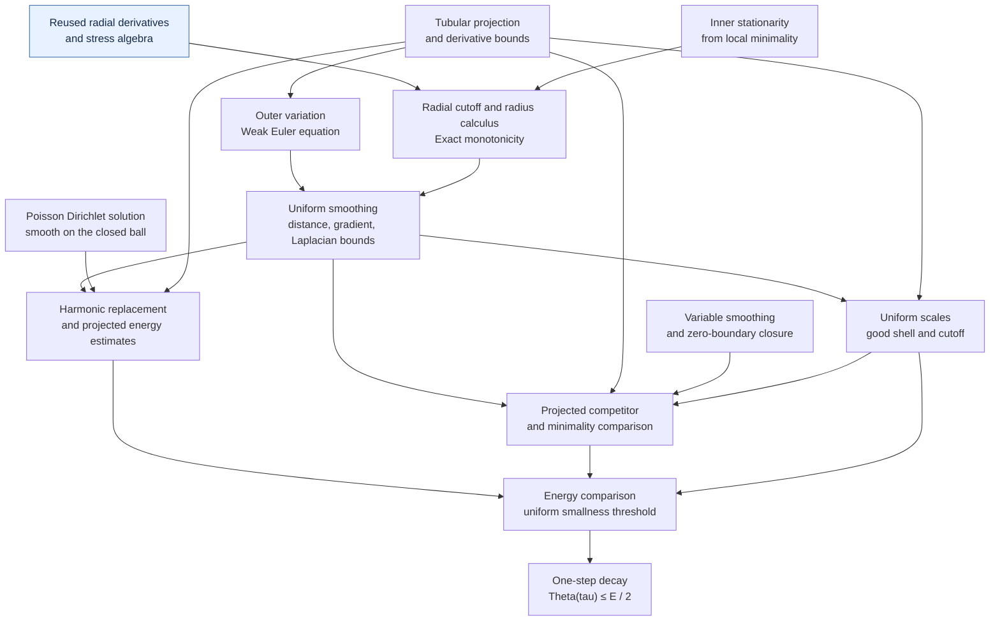
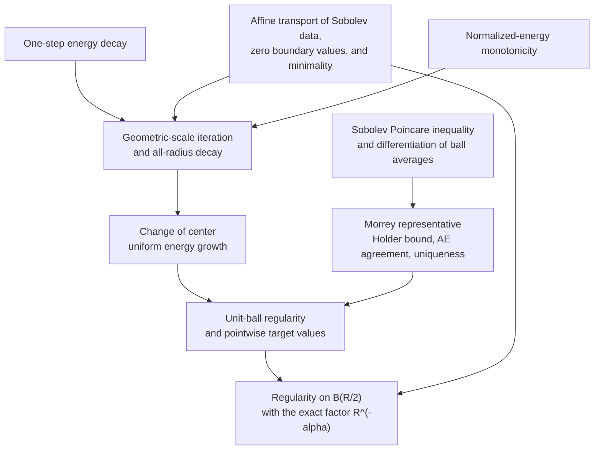

# Schoen–Uhlenbeck small-energy regularity, formalized in Lean 4

A Lean 4 formalization of quantitative small-energy Hölder regularity for
locally energy-minimizing harmonic maps into a compact smooth embedded target.
The proof follows Giaquinta–Martinazzi, Section 10.3.1: smoothing, harmonic
replacement, annular comparison, energy decay, and Morrey's argument.

The two principal results are **one-step energy decay** and **small-energy
Hölder regularity**. The development includes the geometric and analytic
ingredients used by these results, including nearest-point projection,
stationarity from minimality, the monotonicity formula, variable smoothing,
and a Poisson construction with smoothness up to the boundary.
The mathematical argument and its source corrections are written in
[sources/OriginalProof.tex](sources/OriginalProof.tex).

## What is proved

Let $n\ge2$ and let $N\subset\mathbb R^q$ be a nonempty compact smooth embedded
submanifold without boundary, with the metric induced by the ambient space.
For an open set $\Omega\subset\mathbb R^n$, let
$u\in W^{1,2}_{\mathrm{loc}}(\Omega,\mathbb R^q)$ take values in $N$ almost
everywhere and locally minimize Dirichlet energy among $N$-valued competitors
whose difference from $u$ belongs to $W^{1,2}_0$ on the comparison ball. Set

$$
E(u;B)=\int_B |Du|_{\mathrm{HS}}^2\,dx,
\qquad
\Theta_u(a,r)=r^{2-n}E(u;B_r(a)).
$$

The energy has **no factor of $1/2$**. In Lean it takes values in
$[0,\infty]$; the small-energy hypotheses imply its finiteness.

**One-step decay.** There are $\varepsilon_{\mathrm{dec}}\gt 0$ and
$0\lt \tau\lt 1/8$, depending only on the dimension and target, such that

$$
E(u;B_1)\le\varepsilon_{\mathrm{dec}}
\quad\Longrightarrow\quad
\Theta_u(0,\tau)\le\tfrac12 E(u;B_1).
$$

**Small-energy regularity.** There are $\varepsilon\gt 0$, $0\lt \alpha\lt 1$ and
$C\ge0$, depending only on the dimension and target, such that, whenever
$\overline{B_R(a)}\subset\Omega$ and $\Theta_u(a,R)\le\varepsilon$, there is
a unique continuous representative $w$ of $u$ on $B_{R/2}(a)$, with values
in $N$, satisfying

$$
|w(x)-w(y)|\le C R^{-\alpha}\sqrt{\Theta_u(a,R)}\,|x-y|^\alpha
\qquad(x,y\in B_{R/2}(a)).
$$

The constants are chosen before the domain, map, weak gradient, center, and
radius. The endpoint conclusion is Hölder continuity of a representative;
the theorem does not state a smoothness bootstrap or partial regularity.
Both results include dimension $n=2$.

## The Lean statement

Import the regularity theorem with:

```lean
import HarmonicMaps.Frozen.SmallEnergyRegularity
```

Its declaration in
[SmallEnergyRegularity.lean](HarmonicMaps/Frozen/SmallEnergyRegularity.lean) is:

```lean
theorem smallEnergyRegularity
    {n q : ℕ} (hn : 2 ≤ n) (N : CompactSmoothEmbeddedTarget q) :
    ∃ ε α : ℝ, ∃ C : ℝ≥0,
      0 < ε ∧ 0 < α ∧ α < 1 ∧
      ∀ (Ω : OpenDomain n) (u : Domain n → Ambient q)
        (Du : Domain n → Gradient n q),
        MemW12Loc Ω u Du →
        TakesValuesIn N Ω u →
        IsLocallyEnergyMinimizing N Ω u Du →
        ∀ (a : Domain n) (R : PositiveRadius),
          Metric.closedBall a R.val ⊆ Ω.val →
          normalizedEnergy Du a R ≤ ENNReal.ofReal ε →
          ∃ w : Metric.ball a (R.val / 2) → Ambient q,
            IsContinuousRepresentative (ballDomain a (R.val / 2)) u w ∧
            (∀ x, w x ∈ N.carrierSet) ∧
            (∀ x y : Metric.ball a (R.val / 2),
              ‖w x - w y‖ ≤
                (C : ℝ) * Real.rpow R.val (-α) *
                  Real.sqrt (normalizedEnergy Du a R).toReal *
                  Real.rpow (dist (x : Domain n) (y : Domain n)) α) ∧
            ∀ v : Metric.ball a (R.val / 2) → Ambient q,
              IsContinuousRepresentative (ballDomain a (R.val / 2)) u v →
              v = w :=
by exact HarmonicMaps.Providers.SmallEnergyRegularity.result hn N
```

This declaration is in namespace `HarmonicMaps`. `Domain n` and `Ambient q`
are Euclidean spaces; `Du` is the displayed weak gradient used throughout the
energy and proof. `IsContinuousRepresentative` includes almost-everywhere
agreement with `u`. The representative's subtype domain makes the uniqueness
claim local to the inner ball.

`MemW12Loc` uses distributional derivatives and local $L^2$ conditions.
`HasZeroBoundaryValues` is defined by closure of compactly supported smooth
maps in the function-and-gradient $L^2$ norm. The target structure contains
smooth embeddedness and compactness; tubular projection and its derivative
estimates are proved consequences. See [Sobolev.lean](HarmonicMaps/Sobolev.lean),
[Target.lean](HarmonicMaps/Target.lean), and
[Minimizer.lean](HarmonicMaps/Minimizer.lean).

## Proof structure

Arrows point from prerequisites to the conclusions they support. These are
mathematical dependency diagrams; routine measure and Sobolev infrastructure
is omitted. The blue node marks code adapted from the earlier stationary-map
project. All the surrounding implications are proved in this development.

### From minimality to one-step decay



Monotonicity supplies centered energy control at every smoothing scale.
The weak Euler equation supplies the smoothed Laplacian estimate. Harmonic
replacement controls the energy of the projected fixed smoothing, while
variable smoothing joins it to the original map across a shell of small
energy. Local minimality then yields the contraction.

### From decay to the Hölder representative



Here $\alpha=\log 2/(2\log(1/\tau))$, so $\tau^{2\alpha}=1/2$.
Iteration gives $\Theta_u(x,r)\le2(r/s)^{2\alpha}\Theta_u(x,s)$.
Reducing the unit-ball threshold to
$\varepsilon=2^{2-n}\varepsilon_{\mathrm{dec}}$ makes the estimate uniform
at every center in the half ball. Morrey's representative is constructed as
the limit of ball averages; closedness of $N$ gives its pointwise target values.

## Mathematical difficulties and source corrections

The [manuscript](sources/OriginalProof.tex), especially its final section,
records the adopted source corrections. The points below also explain the
additional constructions needed to realize the argument in Lean.

- **Consistent scales.** The textbook's earlier choice
  $\bar h=\varepsilon_0^{1/(2n)}$ is inconsistent in general dimension with
  its later identity $2\bar h\varepsilon_0^{-1/8}=2\varepsilon_0^{1/8}$.
  Monotonicity improves the rough smoothing bound to
  $|Dm_h|^2\le C\eta h^{-2}$. The proof consistently uses
  $\bar h=\eta^{1/4}$, $\delta=\eta^{1/8}$ and
  $\tau=\eta^{1/(64(n-1))}$, with scales fixed by a uniform threshold before
  choosing the map. This also covers $n=2$ without dividing by $n-2$.
- **Variations require admissible Sobolev competitors.** Smooth changes of
  variables must preserve the actual weak gradient, target condition, and
  zero-boundary difference. Dominated energy difference quotients then derive
  stationarity from minimality. Stationarity is not an extra hypothesis.
- **Smoothing can vanish on the gluing region.** The derivative of
  $x\mapsto x-s(x)y$ retains the full matrix $I-y\otimes Ds$ and determinant
  $1-Ds\cdot y$. Density and $L^2$ closure identify the weak derivative for
  rough inputs. Almost-everywhere equality on an outer collar establishes
  admissibility without assuming continuity of the original map.
- **Boundary regularity and sphere measure need separate proofs.** Interior
  Poisson smoothness does not justify boundary Green identities. Rotation
  covariance transfers angular derivatives to smooth boundary data; Euler
  radial identities recover the full derivatives on the closed ball.
  The canonical polar measure is also identified with normalized Euclidean
  Hausdorff surface measure, preserving the Poisson normalization.
- **A representative is part of the conclusion.** The Morrey proof identifies
  an all-radius limit of ball averages, proves almost-everywhere agreement,
  and establishes uniqueness among continuous representatives. Affine
  transport carries these properties and the exact radius factor to the
  original ball.

## Main modules

All declaration names below are in namespace `HarmonicMaps`.

| Result or interface | Module |
|---|---|
| `smallEnergyRegularity` | [Frozen/SmallEnergyRegularity](HarmonicMaps/Frozen/SmallEnergyRegularity.lean) |
| `oneStepEnergyDecay` | [Frozen/OneStepEnergyDecay](HarmonicMaps/Frozen/OneStepEnergyDecay.lean) |
| Tubular projection and quantitative derivatives | [Frozen/TubularProjection](HarmonicMaps/Frozen/TubularProjection.lean) |
| Weak Euler equation | [Frozen/OuterVariation](HarmonicMaps/Frozen/OuterVariation.lean) |
| Uniform smoothing estimates | [Frozen/UniformSmoothing](HarmonicMaps/Frozen/UniformSmoothing.lean) |
| `IsLocallyEnergyMinimizing.monotonicity` | [Analysis/Monotonicity](HarmonicMaps/Analysis/Monotonicity.lean) |
| Variable-radius smoothing | [Analysis/VariableMollification](HarmonicMaps/Analysis/VariableMollification.lean) |
| Poisson solution and native Sobolev data | [Analysis/PoissonSourceDirichlet](HarmonicMaps/Analysis/PoissonSourceDirichlet.lean) |
| Harmonic replacement estimates | [Analysis/HarmonicReplacementEstimates](HarmonicMaps/Analysis/HarmonicReplacementEstimates.lean) |
| Energy iteration and centered growth | [Analysis/EnergyIteration](HarmonicMaps/Analysis/EnergyIteration.lean), [Analysis/CenteredEnergyGrowth](HarmonicMaps/Analysis/CenteredEnergyGrowth.lean) |
| `morrey_representative` | [Analysis/MorreyRepresentative](HarmonicMaps/Analysis/MorreyRepresentative.lean) |
| Arbitrary-ball assembly | [Analysis/GeneralBallRegularity](HarmonicMaps/Analysis/GeneralBallRegularity.lean) |

## Building and checking

The project pins **Lean 4.32.2** and Mathlib commit
`905b95818eb32af7874a58b427f50c1711a5e96c`. With `elan` and Python 3 installed:

```sh
lake exe cache get
lake build
python3 scripts/check_axioms.py
python3 scripts/check_statements.py
```

The default build checks all 244 project Lean modules. The source scan finds
no unfinished proofs or project axioms. All 37 theorem dependency closures
checked by the audit use only `propext`, `Classical.choice`, and `Quot.sound`;
all 11 stored theorem-type fingerprints match.

Keep the committed `lean-toolchain` and `lake-manifest.json` when reproducing
this version. The axiom check tests the exported results against Lean's
standard `propext`, `Classical.choice`, and `Quot.sound`; the statement check
compares 11 elaborated theorem types with the saved baselines in
`verification/`. It does not unfold or independently check the foundational
definitions. Kernel checking verifies the formal
propositions. The displayed statements and definitions make their mathematical
scope available for separate inspection.

## Reuse and acknowledgments

We thank **Scott Armstrong** for
[LeanAutoformalizationSkills](https://github.com/scottnarmstrong/LeanAutoformalizationSkills),
used for statement audits, proof dependency analysis, proof development, and
release checks. The installed revision was
`05a07311f16bc581729e52f3e73647b95fa9bef1`; the collection is licensed under
[CC BY 4.0](https://creativecommons.org/licenses/by/4.0/).
The presentation also takes inspiration from the
[Caffarelli–Kohn–Nirenberg formalization](https://github.com/scottnarmstrong/CaffarelliKohnNirenberg).

Our earlier [LeanStationaryHarmonicMaps](https://github.com/BrookWW/LeanStationaryHarmonicMaps)
provides the radial vector-field calculus and stress algebra adapted in
`RadialStressBasic`, `RadialVectorField`, `RadialStressAlgebra`, and
`RadialStressGeometry`, under `HarmonicMaps/Analysis/`. Their source is
[`RadialGeometry.lean` at revision `bde641f98085e5a0443c10779a6fe519190b6adc`](https://github.com/BrookWW/LeanStationaryHarmonicMaps/blob/bde641f98085e5a0443c10779a6fe519190b6adc/LeanStationaryHarmonicMaps/StationaryHarmonicMap/RadialGeometry.lean).
These four files retain their MIT notices; the license is also preserved in
[LICENSES/LeanStationaryHarmonicMaps-MIT.txt](LICENSES/LeanStationaryHarmonicMaps-MIT.txt).
The explicit-gradient Sobolev design is shared with that project. Here the
interfaces use smooth scalar tests and coordinatewise $L^2$ data, and the
full monotonicity theorem is proved from this project's local minimality.

The mathematical sources are Giaquinta–Martinazzi,
*An Introduction to the Regularity Theory for Elliptic Systems, Harmonic Maps
and Minimal Graphs*, second edition, Section 10.3.1, and Schoen–Uhlenbeck,
[*A regularity theory for harmonic maps*](https://doi.org/10.4310/jdg/1214436923),
*Journal of Differential Geometry* **17** (1982), 307–335. The formalized proof
is the textbook route detailed in the included manuscript. Mathlib supplies
the underlying analysis, measure theory, manifold, and integration libraries.
Third-party material retains its own licensing terms; no repository-wide
license is assigned to the new project material.
