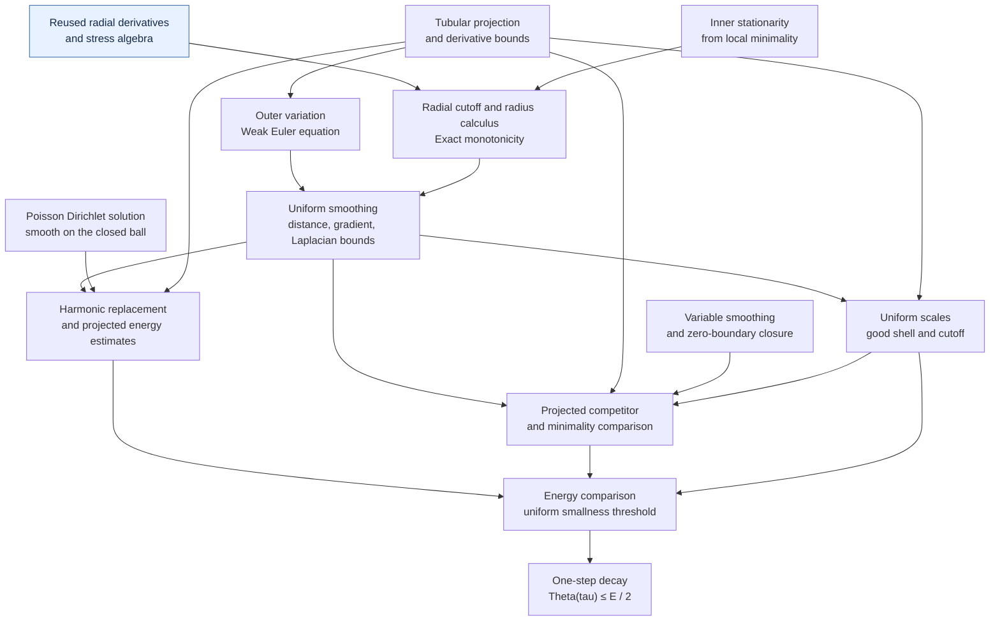
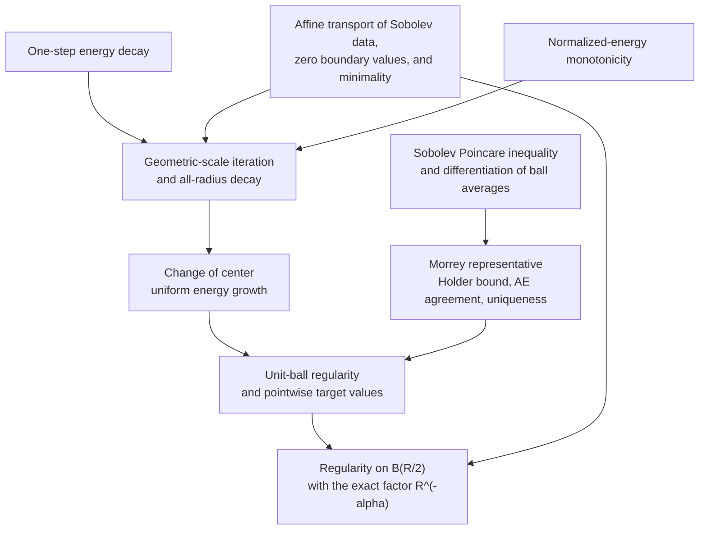
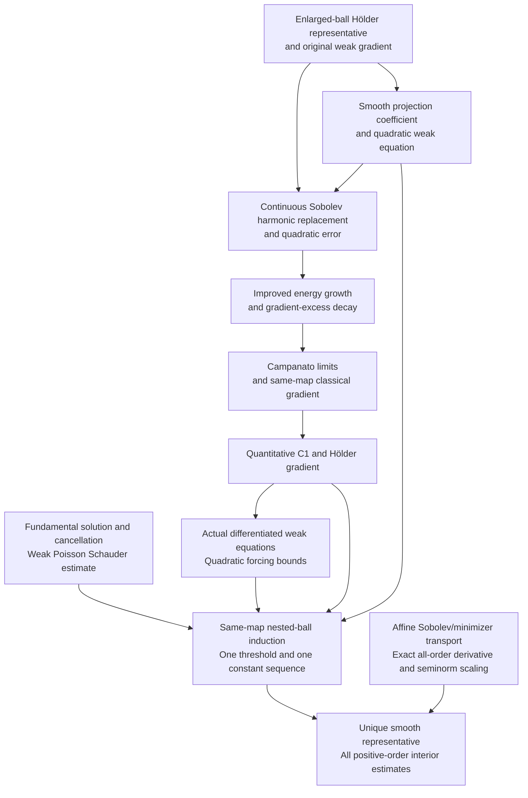

# Schoen–Uhlenbeck small-energy regularity in Lean 4

[](https://github.com/BrookWW/SchoenUhlenbeckSmallEnergyRegularityFormalization/actions/workflows/build.yml)
[](https://github.com/BrookWW/SchoenUhlenbeckSmallEnergyRegularityFormalization/actions/workflows/kernel.yml)

A Lean 4 formalization of **interior smooth small-energy regularity** for
locally energy-minimizing harmonic maps into compact smooth embedded targets.
One positive energy threshold gives a unique smooth representative and
quantitative bounds at every positive derivative order. The development
includes the quantitative Hölder representative, its smooth upgrade, and the
geometric and analytic proofs required by both results.

The repository is one Lake project with two libraries. `HarmonicMaps` supplies
Sobolev and minimizer data, projection geometry, stationarity, energy decay and
the Hölder representative. `HolderToCK` uses these same objects to prove
quadratic-Poisson C1 regularity, weak Poisson Schauder estimates, smoothness and
all-order derivative bounds. The mathematical arguments are in
[sources/OriginalProof.tex](sources/OriginalProof.tex) and
[sources/holder_to_ck_regularity.tex](sources/holder_to_ck_regularity.tex).
The scope is interior regularity on Euclidean source domains; boundary and
singular-set regularity are separate results.

## What is proved

Let $n\ge2$ and let $N\subset\mathbb R^q$ be a nonempty compact smooth embedded
submanifold without boundary, with its induced Euclidean metric. Let
$u\in W^{1,2}_{\mathrm{loc}}(\Omega,\mathbb R^q)$ take values in $N$ almost
everywhere and locally minimize Dirichlet energy among $N$-valued competitors
whose difference from $u$ belongs to $W^{1,2}_0$ on each comparison ball. Set

```math
E(u;B)=\int_B |Du|_{\mathrm{HS}}^2\,dx,
\qquad
\Theta_u(a,R)=R^{2-n}E(u;B_R(a)).
```

Energy has **no factor of $1/2$**. Higher derivatives use ambient multilinear
operator norms. The displayed weak gradient is retained in Sobolev membership,
the equation and the energy.

**Smooth small-energy regularity.** There are $\varepsilon\gt0$,
$0\lt\gamma\lt1$, and one sequence $C_0,C_1,\ldots$ of finite nonnegative
constants, depending only on $n,N$ (and, for $C_k$, on $k$), such that
$\overline{B_R(a)}\subset\Omega$ and $\Theta_u(a,R)\le\varepsilon$ imply a
unique continuous representative $w$ on $B_{R/2}(a)$ with values in $N$.
This representative is smooth and satisfies

```math
\sup_{B_{R/2}(a)} |w-w(a)|\le C_0\sqrt{\Theta_u(a,R)},
```

```math
\begin{aligned}
R^k\sup_{B_{R/2}(a)}\|D^kw\|
&\le C_k\sqrt{\Theta_u(a,R)},\\
R^{k+\gamma}[D^kw]_{\gamma;B_{R/2}(a)}
&\le C_k\sqrt{\Theta_u(a,R)},\qquad k\ge1.
\end{aligned}
```

The threshold, exponent and entire constant sequence are chosen before the
domain, map, weak gradient, center, radius and derivative order. Every order
concerns derivatives of the same representative. The theorem includes $n=2$
and zero energy.

**Quantitative Hölder regularity.** `HarmonicMaps.smallEnergyRegularity`
provides the same local continuous representative with
$|w(x)-w(y)|\le C R^{-\alpha}\sqrt{\Theta_u(a,R)}|x-y|^\alpha$.
The Hölder and smooth representatives agree by local almost-everywhere
uniqueness. Their available thresholds need not be equal.

**One-step decay.** `HarmonicMaps.oneStepEnergyDecay` gives fixed
$\varepsilon_{\mathrm{dec}}\gt0$ and $0\lt\tau\lt1/8$ such that
$E(u;B_1)\le\varepsilon_{\mathrm{dec}}$ implies
$\Theta_u(0,\tau)\le\tfrac12E(u;B_1)$.

## Lean interface

Import the combined source-facing results with:

```lean
module
public import HarmonicMaps.Regularity

#check HarmonicMaps.oneStepEnergyDecay
#check HarmonicMaps.smallEnergyRegularity
#check HolderToCK.smallEnergySmoothRegularity
```

The complete smooth theorem is in namespace `HolderToCK`, in
[SmallEnergySmoothRegularity.lean](HolderToCK/Frozen/SmallEnergySmoothRegularity.lean).
The following standalone example checks its complete interface using the
public theorem.

```lean
module
public import HarmonicMaps.Regularity

open HarmonicMaps MeasureTheory Set HolderToCK
open scoped NNReal ENNReal ContDiff
set_option autoImplicit false

example
    {n q : ℕ} (hn : 2 ≤ n) (N : CompactSmoothEmbeddedTarget q) :
    ∃ ε γ : ℝ, ∃ C : ℕ → ℝ≥0,
      0 < ε ∧ 0 < γ ∧ γ < 1 ∧
      ∀ (Ω : OpenDomain n) (u : Domain n → Ambient q)
        (Du : Domain n → Gradient n q),
        MemW12Loc Ω u Du → TakesValuesIn N Ω u →
        IsLocallyEnergyMinimizing N Ω u Du →
        ∀ (a : Domain n) (R : PositiveRadius),
          Metric.closedBall a R.val ⊆ Ω.val →
          normalizedEnergy Du a R ≤ ENNReal.ofReal ε →
          ∃ w : Domain n → Ambient q,
            ContDiffOn ℝ ∞ w (Metric.ball a (R.val / 2)) ∧
            IsContinuousRepresentative (ballDomain a (R.val / 2)) u
              (fun x => w x.val) ∧
            (∀ x ∈ Metric.ball a (R.val / 2), w x ∈ N.carrierSet) ∧
            (∀ x ∈ Metric.ball a (R.val / 2),
              ‖w x - w a‖ ≤ (C 0 : ℝ) *
                Real.sqrt (normalizedEnergy Du a R).toReal) ∧
            (∀ k : ℕ, 1 ≤ k → ∀ x ∈ Metric.ball a (R.val / 2),
              ‖iteratedFDeriv ℝ k w x‖ ≤ (C k : ℝ) *
                Real.rpow R.val (-(k : ℝ)) *
                Real.sqrt (normalizedEnergy Du a R).toReal) ∧
            (∀ k : ℕ, 1 ≤ k →
              HolderBoundOn (Metric.ball a (R.val / 2))
                (iteratedFDeriv ℝ k w) γ
                ((C k : ℝ) * Real.rpow R.val (-((k : ℝ) + γ)) *
                  Real.sqrt (normalizedEnergy Du a R).toReal)) ∧
            ∀ v : Domain n → Ambient q,
              IsContinuousRepresentative (ballDomain a (R.val / 2)) u
                (fun x => v x.val) →
              Set.EqOn v w (Metric.ball a (R.val / 2)) :=
by exact HolderToCK.smallEnergySmoothRegularity hn N
```

`Domain n` and `Ambient q` are Euclidean spaces. `Du` is the displayed weak
gradient, and `IsContinuousRepresentative` includes almost-everywhere agreement
with `u`. The conclusion `EqOn` gives uniqueness on the source half ball.
`ContDiffOn ℝ ∞` gives every finite `Ck` regularity conclusion for this same map.

`MemW12Loc` uses distributional derivatives and actual local $L^2$ data.
`HasZeroBoundaryValues` is the function-and-gradient $L^2$ closure of smooth
compactly supported maps. Smooth embeddedness and compactness are geometric
data; tubular projection and its derivative estimates are proved consequences.
See [Sobolev.lean](HarmonicMaps/Sobolev.lean), [Target.lean](HarmonicMaps/Target.lean)
and [Minimizer.lean](HarmonicMaps/Minimizer.lean).

## Proof structure

Arrows describe mathematical dependencies. Both libraries share the actual
Sobolev, target, minimizer and energy definitions. The detailed upgrade and
its constant choices are explained in [docs/regularity.md](docs/regularity.md).

### From minimality to one-step decay



Monotonicity supplies centered energy control at every smoothing scale.
The weak Euler equation supplies the smoothed Laplacian estimate. Harmonic
replacement controls the energy of the projected fixed smoothing, while
variable smoothing joins it to the original map across a shell of small
energy. Local minimality then yields the contraction.

### From decay to the Hölder representative



Here $\alpha=\log 2/(2\log(1/\tau))$, so $\tau^{2\alpha}=1/2$.
Iteration gives $\Theta_u(x,r)\le2(r/s)^{2\alpha}\Theta_u(x,s)$.
Reducing the unit-ball threshold to
$\varepsilon=2^{2-n}\varepsilon_{\mathrm{dec}}$ makes the estimate uniform
at every center in the half ball. Morrey's representative is constructed as
the limit of ball averages; closedness of $N$ gives its pointwise target values.


### From the Hölder representative to smoothness



The C1 gate is proved from harmonic comparison and Campanato decay. The
Schauder estimate is proved using the fundamental solution, Hessian
cancellation and the correctly signed distributional point term. Differentiated
weak equations and quadratic product estimates supply each induction step.
All affine scaling uses the original map and its actual weak gradient.

## Main exports and modules

| Result | Namespace / module |
|---|---|
| Complete entry point | [HarmonicMaps.Regularity](HarmonicMaps/Regularity.lean) |
| Smooth small-energy regularity | [HolderToCK.smallEnergySmoothRegularity](HolderToCK/Frozen/SmallEnergySmoothRegularity.lean) |
| Hölder small-energy regularity | [HarmonicMaps.smallEnergyRegularity](HarmonicMaps/Frozen/SmallEnergyRegularity.lean) |
| One-step energy decay | [HarmonicMaps.oneStepEnergyDecay](HarmonicMaps/Frozen/OneStepEnergyDecay.lean) |
| Quantitative quadratic-Poisson C1 | [HolderToCK.holderQuadraticPoissonC1](HolderToCK/Frozen/HolderQuadraticPoissonC1.lean) |
| Weak Poisson interior Schauder | [HolderToCK.poissonInteriorSchauder](HolderToCK/Frozen/PoissonInteriorSchauder.lean) |
| Local quadratic-Poisson smoothness without minimality | [HolderToCK.holderQuadraticPoisson_smooth](HolderToCK/Frozen/HolderQuadraticPoissonSmooth.lean) |
| Projection geometry and weak Euler equation | [TubularProjection](HarmonicMaps/Frozen/TubularProjection.lean), [OuterVariation](HarmonicMaps/Frozen/OuterVariation.lean) |
| Uniform smoothing and monotonicity | [UniformSmoothing](HarmonicMaps/Frozen/UniformSmoothing.lean), [Monotonicity](HarmonicMaps/Analysis/Monotonicity.lean) |
| Nested-ball quantitative induction | [UniformThreshold](HolderToCK/Analysis/Bootstrap/UniformThreshold.lean) |
| Literal Hölder seminorm and exact affine equality | [HolderSeminorm](HolderToCK/Foundation/HolderSeminorm.lean), [AffineSeminorm](HolderToCK/Analysis/Bootstrap/AffineSeminorm.lean) |

The generic quadratic-Poisson smoothness export uses local Hölder data and the
actual smooth-coefficient equation; it assumes no energy-minimizing property
or target manifold. It is a separate reusable consequence of the analytic
bootstrap.

## Build and verify

The project pins **Lean 4.32.2** and Mathlib commit
`905b95818eb32af7874a58b427f50c1711a5e96c`. Mathlib is the sole directly declared
external Lake dependency. Both mathematical libraries belong to this package
and are maintained together in this repository. Mathematical interfaces and
their verification baselines are reviewed and updated here.
With `elan` and Python 3.9 or later installed:

```sh
lake exe cache get
lake build
python3 scripts/check_sources.py
python3 scripts/check_statements.py
python3 scripts/check_axioms.py
```

The default build covers both libraries and all **376 Lean modules**. The source
scan admits no unfinished proof, project axiom or native trust bypass.
The axiom checks cover the advertised theorem chain and **632 registered
upgrade/interface exports**, allowing only `propext`, `Classical.choice` and
`Quot.sound`. All **15 stored complete theorem-type fingerprints** match their
baselines. Source checks protect the two manuscripts, the meaning-carrying
foundation files, all 131 upgrade modules and the fixed build configuration.
There are no draft theorem exports.

To replay the compiled project declarations through the pinned Lean kernel:

```sh
LEAN_NUM_THREADS=2 lake --no-build env leanchecker HarmonicMaps HolderToCK -v
```

This is Lean's compiled-declaration replay tool. Type fingerprints check the
complete elaborated interfaces; source fingerprints check supplied byte
baselines. Mathematical interpretation is documented in the statements,
foundational definitions and manuscripts.

The [build workflow](https://github.com/BrookWW/SchoenUhlenbeckSmallEnergyRegularityFormalization/actions/workflows/build.yml)
runs both-library builds, source checks, theorem-type checks and axiom checks.
The [kernel workflow](https://github.com/BrookWW/SchoenUhlenbeckSmallEnergyRegularityFormalization/actions/workflows/kernel.yml)
also runs compiled-declaration replay. Both support manual dispatch and run
for pushes to `main` and pull requests, with separate build caches. Keep the
committed toolchain and dependency lockfile when reproducing the development.

## Reuse and acknowledgments

We gratefully acknowledge
[LeanAutoformalizationSkills](https://github.com/scottnarmstrong/LeanAutoformalizationSkills),
developed by [**Scott Armstrong**](https://github.com/scottnarmstrong), which we
used for statement audits, proof dependency analysis, proof development, and
release checks. The installed revision was
`05a07311f16bc581729e52f3e73647b95fa9bef1`; the collection is licensed under
[CC BY 4.0](https://creativecommons.org/licenses/by/4.0/).

Our earlier [LeanStationaryHarmonicMaps](https://github.com/BrookWW/LeanStationaryHarmonicMaps)
provides the radial vector-field calculus and stress algebra adapted in
`RadialStressBasic`, `RadialVectorField`, `RadialStressAlgebra`, and
`RadialStressGeometry`, under `HarmonicMaps/Analysis/`. Their source is
[`RadialGeometry.lean` at revision `bde641f98085e5a0443c10779a6fe519190b6adc`](https://github.com/BrookWW/LeanStationaryHarmonicMaps/blob/bde641f98085e5a0443c10779a6fe519190b6adc/LeanStationaryHarmonicMaps/StationaryHarmonicMap/RadialGeometry.lean).
These four files retain their MIT notices; the license is also preserved in
[LICENSES/LeanStationaryHarmonicMaps-MIT.txt](LICENSES/LeanStationaryHarmonicMaps-MIT.txt).
The explicit-gradient Sobolev design is shared with that project. Here the
interfaces use smooth scalar tests and coordinatewise $L^2$ data, and the
full monotonicity theorem is proved from this project's local minimality.

The mathematical sources are Giaquinta–Martinazzi,
*An Introduction to the Regularity Theory for Elliptic Systems, Harmonic Maps
and Minimal Graphs*, second edition, Section 10.3.1, Theorem 9.7 and Proposition 10.40, and
Schoen–Uhlenbeck,
[*A regularity theory for harmonic maps*](https://doi.org/10.4310/jdg/1214436923),
*Journal of Differential Geometry* **17** (1982), 307–335. The formalized proof
is the textbook route detailed in the included manuscript. Mathlib supplies
the underlying analysis, measure theory, manifold, and integration libraries.
Third-party material retains its own licensing terms; no repository-wide
license is assigned to the new project material.
